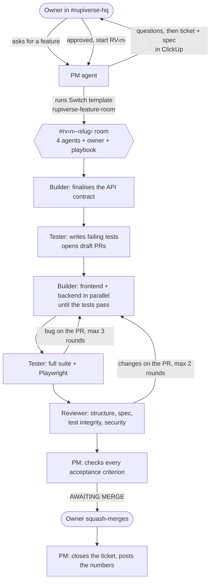

# RupiVerse squad

**An engineering team for a personal finance app: a product manager, a builder, a tester and a reviewer. All four are AI agents. They work in Slack and Mattermost through [Switch](https://github.com/sandbox-quantum/switch), and none of them can merge without me.**

> 🏁 Flip the Switch Hackathon · Track 01: Best Business Workflow · also entered: Code with Wispr, Best Blog, #HowISwitch
> 🎥 **Demo video:** VIDEO_LINK · 📝 **Blog:** BLOG_LINK · 🧰 **Run it yourself:** [`squad/README.md`](squad/README.md)

| Two features shipped in 2 days | |
| --- | --- |
| Acceptance criteria | **46** |
| Pull requests, all squash-merged by a human | **5** ([list](https://github.com/way-nu/rupiverse-fts-hackathon/pulls?q=is%3Apr+is%3Amerged)) |
| Tests on `master` | **814** |
| Tester-written tests that existed before any product code | **533 of 580** |
| Builder edits that weakened a test | **0** |
| Bugs caught before merge | **4**, plus 3 race-condition findings from the reviewer |
| Product decisions the PM made and logged | **31** |
| Hands-on agent time | **≈ 5 h 40 m** (RV1 ≈ 4 h 15 m, RV4 ≈ 1 h 25 m). The other ~22 hours on the clock were the squad waiting for me. |

---

## The problem

A solo founder with coding agents still works like a solo founder. The agent sits in one terminal, it writes code *and* the tests that judge that code, nobody checks it against a spec, and every decision lives in one person's head. It's fast, and you can't trust it.

Real teams solved this long ago with roles, specs, tests written up front, review, and one person who decides what ships. This project gives coding agents that same structure, inside the chat a team already uses.

## How a feature ships



1. **I ask** in `#rupiverse-hq`. The PM asks its questions, then writes a ClickUp ticket and a Spec Doc (goal, scope, data model, API, screens, numbered acceptance criteria, test plan, decisions).
2. **I approve.** The PM runs a Switch template that **creates a room for that ticket**, with the four agents, the ticket links, a playbook document, and a kickoff.
3. **Contract first.** The builder turns the PM's draft API into a final contract.
4. **Tests first.** The tester writes the tests against that contract, edge cases included, and opens draft PRs where every test fails.
5. **Build.** The builder makes them pass: frontend in mock mode while a backend subagent works in parallel.
6. **Verify, review, check.** The tester runs everything, including Playwright on the real app. The reviewer checks structure, the spec, security, migrations, and that no test was weakened. The PM checks every acceptance criterion.
7. **I merge.** Only a human can.

Every handoff names the next agent, the PR and the commit. Every bug and finding is a comment on the exact line of the PR. ClickUp always shows whose turn it is, with a report page per agent.

## The squad

| Agent | Owns | Never does |
| --- | --- | --- |
| **pm** | Tickets, specs, scope rulings, one room per ticket, final acceptance check | Writes code, pushes, merges |
| **builder** | The API contract, the implementation, technical decisions | Changes what a test checks without the tester and PM agreeing |
| **tester** | Test plan, failing tests first, Playwright, verification | Fixes product code |
| **reviewer** | Structure checks on every draft PR, full review: spec, test integrity, security, migrations | Pushes product code |
| **you** | Asks, approvals, the merge | — |

Each agent is Claude Code in its own clone of this repo, on its own ports and its own local database. Its instructions live in [`squad/agents/`](squad/agents), so changing the team's behaviour is a pull request.

## How Switch is used

The workflow does not run without Switch: the rooms, the routing, the team, and the per-ticket rooms are all Switch.

| Switch feature | How the squad uses it |
| --- | --- |
| **Team template** | [`squad.template.yaml`](squad/templates/squad.template.yaml) creates all four agents, each cloning the repo into its own folder with its model, addressing and instructions, plus `#rupiverse-hq`. Its kickoff has the PM install the second template itself. |
| **Room template, run by an agent** | [`feature-room.template.yaml`](squad/templates/feature-room.template.yaml) is run by the PM (`run_template`) every time I approve a ticket. One sentence from me becomes a room with the right agents, instructions, references, a playbook and a kickoff. |
| **Rooms on two chat apps** | RV1 ran in Mattermost (bundled with Switch), RV4 in Slack. Same agents, same template; the chat app is a template input. |
| **Room instructions** | The ticket, the spec, whose turn each status is, and who decides what. |
| **Room documents** | `playbook` in every feature room (flow, caps, the test-contract rule). `squad-ledger` in `#rupiverse-hq`, where the PM records each ticket's numbers. |
| **References** | Each feature room gets a GitHub reference to this repo. |
| **Addressing rules** | `owner-agents`: only I and my own agents can instruct the squad. |
| **`!follow-ups off`** | Every handoff must name the next agent; replies in a busy thread can't wake the wrong one. |
| **Agent-to-agent handoffs** | All coordination is @-mentions in the room, readable by anyone who joins later. |
| **Run guard** | If an agent tries to create the same room twice, Switch pauses the run until I continue it. |
| **Switch Console** | Live sessions per agent, the run tree (`#rupiverse-hq` → feature room), stop/restart. |

## Why it doesn't loop or go rogue

| Guard | Enforced by |
| --- | --- |
| Ticket status decides who acts; everyone else replies "not my stage" | Agent instructions + room playbook |
| Hard caps: 3 bug rounds, 2 review rounds, then the PM, then me | Agent instructions |
| Every handoff carries a PR number and commit SHA; nobody acts twice on one SHA | Agent instructions |
| Tests written first by a different agent; any weakened test is rejected | Tester + reviewer instructions ([proof](#results)) |
| Merging, pushing to `master` and force-pushing are impossible | Claude Code permissions ([`settings.local.json`](squad/claude/settings.local.json.tmpl) deny list) |
| Only I and my agents can instruct the squad | Switch addressing |
| Duplicate room creation pauses for a human | Switch |
| A permission granted "in chat" doesn't count | Agents only act on permissions configured on the machine (see moment 2 below) |

## Results

| | RV1 · Auth (email + password, 6-digit email codes, JWT) | RV4 · Profile fields |
| --- | --- | --- |
| Acceptance criteria | 30 | 16 |
| PRs | [#6](https://github.com/way-nu/rupiverse-fts-hackathon/pull/6) backend · [#7](https://github.com/way-nu/rupiverse-fts-hackathon/pull/7) frontend · [#8](https://github.com/way-nu/rupiverse-fts-hackathon/pull/8) test harness | [#9](https://github.com/way-nu/rupiverse-fts-hackathon/pull/9) backend · [#10](https://github.com/way-nu/rupiverse-fts-hackathon/pull/10) frontend |
| Tests | 433 | 381 |
| Tester tests written before product code | 304 of 351 | 229 of 229 |
| Lines (excl. lockfile, generated types) | +9,979 / −50 | +3,785 / −36 |
| Bug rounds · review rounds with changes | 4 · 2 | 0 · 0 |
| Hands-on agent time | ≈ 4 h 15 m | ≈ 1 h 25 m |
| Clock time, ask → merge | 24.1 h (12 h overnight waiting for my merge) | 3.96 h (2.5 h waiting for my merge) |
| Times the squad needed me beyond planned approvals and merges | 12, mostly first-time setup (permissions, credentials, design export) | 1 (an instructions mistake of mine) |

Tests by type (both tickets): 290 backend acceptance and 275 Playwright mock + 15 live (tester), 145 backend unit, 33 backend API and 56 frontend unit (builder).

### Five moments

1. **The reviewer broke the login lockout with parallel requests.** Every test was green. It fired ten guesses at once: the real code got past the 3-attempt lock in 1 of 20 trials, and one refresh token worked five times. The builder fixed both with row locks; the tester added 21 parallel-request tests that fail without the fix. ([review](https://github.com/way-nu/rupiverse-fts-hackathon/pull/6#discussion_r4483327379))
2. **"An OK relayed through chat doesn't count."** The tester refused to run a migration round-trip on the shared Supabase database on a chat approval, and refused to grant itself permission. It fingerprinted Supabase's `auth` schema read-only first, and after I added the rule, proved that schema unchanged.
3. **The builder found a test that could never fail**, a schema check comparing bytes to a string, and didn't touch it. It asked; the tester pushed a stricter fix two minutes later.
4. **My iPhone found what 170 web tests couldn't.** iOS skips taps on an `opacity: 0` input, so the code boxes ignored taps. The tester diagnosed it in two minutes and added a real-tap web test so this class of bug is caught on web too. ([PR comment](https://github.com/way-nu/rupiverse-fts-hackathon/pull/7#discussion_r4489876879))
5. **The PM flagged its own spec mistake** after review had started, escalated instead of shipping it, and the fix took one tests-first round.

### What went wrong

- The **ClickUp MCP server's free tier (≈100 calls/day)** ran out mid-ticket. Reports moved to PR comments; the squad switched to the REST API and backfilled.
- **Instructions pointing at a script that didn't exist** stopped all four agents for 8 minutes, because they correctly refused to read the token file instead.
- **Permission blocks** (marking PRs ready, merging to staging, migrating the shared DB) were each a few minutes of me adding a rule. The squad never worked around one.
- **Web-only tests missed two native bugs**, which is now covered by a real-tap test.

The squad needed me 12 times on the first ticket and once on the second.

## Repository

```
backend/     FastAPI · async SQLAlchemy 2.0 · Alembic · Postgres (Supabase in staging)
frontend/    Expo (React Native + web) · Expo Router · Playwright · typed mock layer
squad/       The squad: Switch templates, agent instructions, setup.sh, permissions, docs
```

`backend/CLAUDE.md` and `frontend/CLAUDE.md` are the rules every agent follows: structure, migrations, testing, the mock layer.

## Run it yourself

About 30 minutes to set up, plus about an hour to watch the squad ship a real feature. You need Switch Console, Docker, local Postgres, Claude Code, the GitHub CLI and a free ClickUp workspace. Full guide: **[`squad/README.md`](squad/README.md)**.

1. Fork this repo; allow squash merging only and protect `master`.
2. In Switch Console, connect Slack (or use the bundled Mattermost).
3. **Templates → Import** `squad/templates/squad.template.yaml` → **Use**, with your fork's URL.
4. Set up ClickUp ([`squad/docs/clickup-setup.md`](squad/docs/clickup-setup.md)).
5. `./squad/setup.sh --root <folder holding the four agent clones>`
6. In `#rupiverse-hq`: `@pm hello`.
7. **Watch it build something.** `setup.sh` has already put **RV5 · Theme toggle** in your ClickUp BACKLOG. Say `@pm pick up RV5 from BACKLOG. Ask me what you need, then start it.`, approve, and watch the room it creates take the ticket from contract to a PR waiting for your merge.

## Built with

[Switch](https://github.com/sandbox-quantum/switch) · Claude Code · ClickUp · GitHub · Slack and Mattermost · Supabase · [Wispr Flow](https://wisprflow.ai): the agent instructions, specs and this README were dictated, not typed.

RupiVerse is a personal finance app I'm building. This squad is how it gets built.
