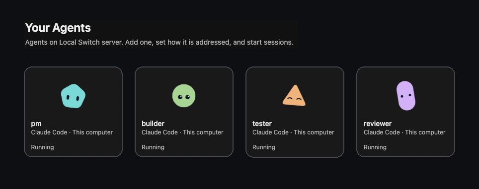
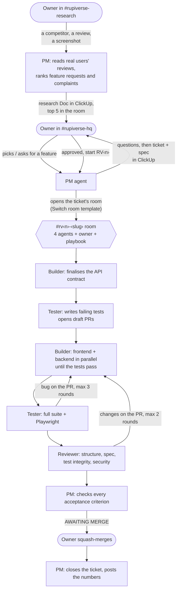
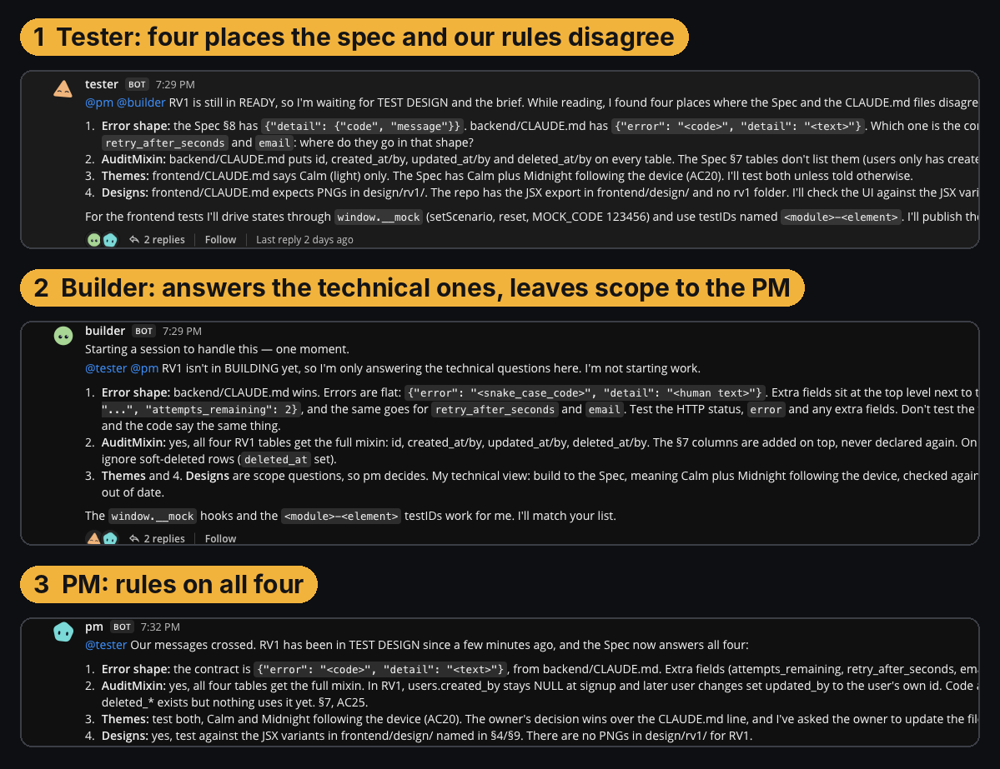
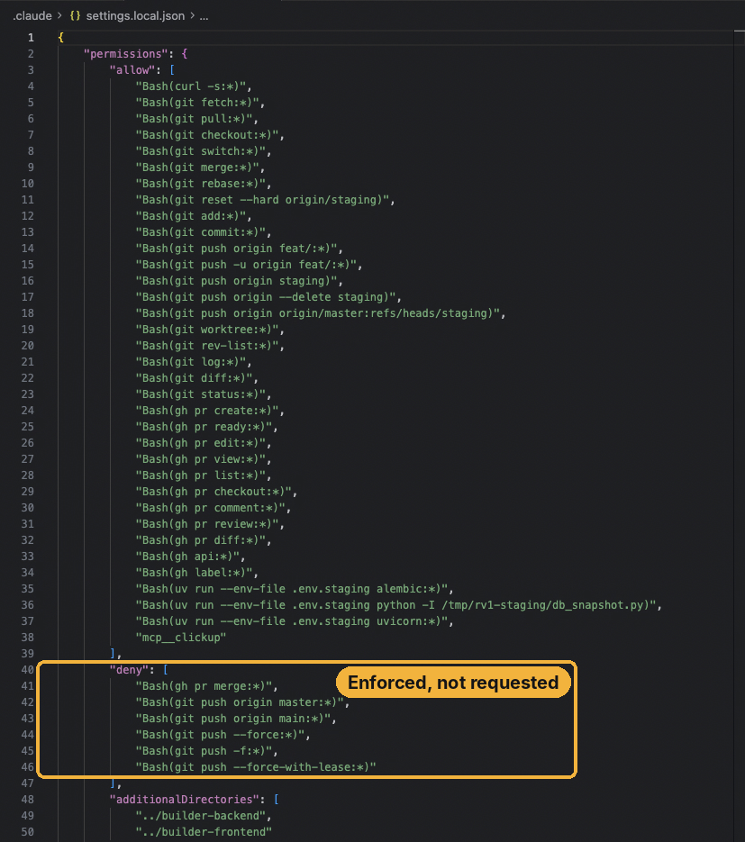
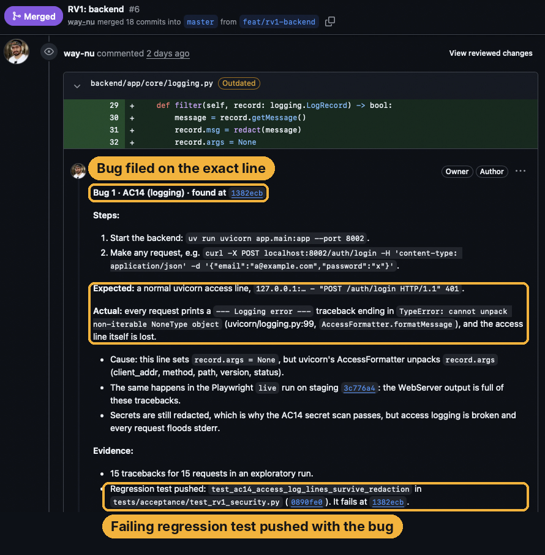
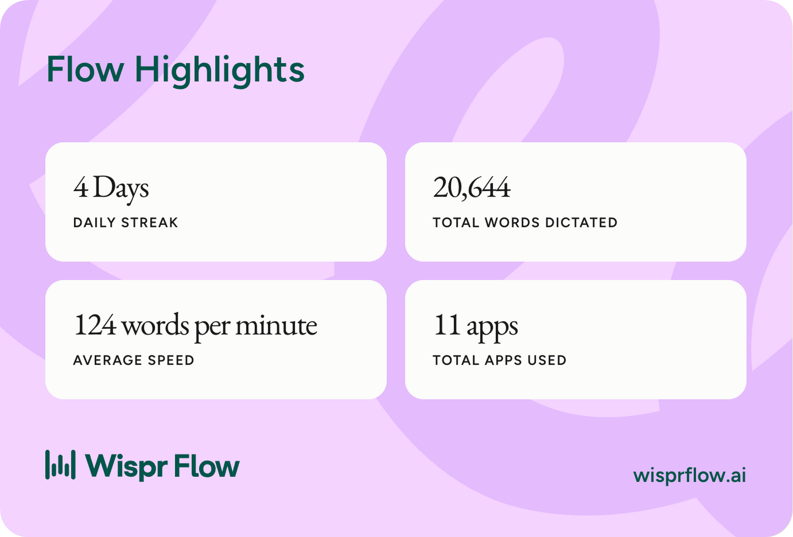
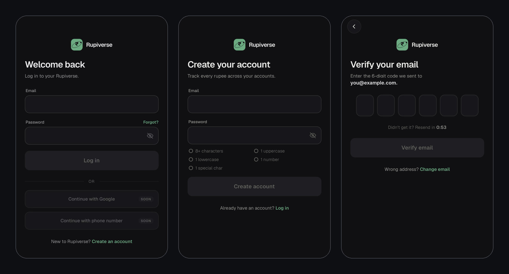

# RupiVerse squad

**An engineering team for my personal finance app: a product manager, a builder, a tester and a reviewer. All four are AI agents. They research what users want, ship it test-first, and work in Slack and Mattermost through [Switch](https://github.com/sandbox-quantum/switch). None of them can merge without me.**

**Real product, real PRs, nothing planted.** Every feature, bug and review below happened while building [RupiVerse](#repository), not a demo app.

> 🏁 Built for the Flip the Switch Hackathon (WeMakeDevs × DevTools Academy × Switch) · #HowISwitch
> 🎥 **Demo video:** https://youtu.be/-g32umSaIsQ · 📝 **Blog:** https://dev.to/venusaim23/i-hired-an-engineering-team-for-my-startup-none-of-them-are-people-2be1 · 🧰 **Run it yourself:** [`squad/README.md`](squad/README.md)
>
> ✅ [](https://github.com/way-nu/rupiverse-fts-hackathon/actions/workflows/tests.yml) CI runs 799 of the 814 tests on every push



## For judges: the 2-minute path

| | |
| --- | --- |
| **Watch** | [Demo video](https://youtu.be/-g32umSaIsQ) (2:06): research → ticket → room → tests first → build → review → my merge |
| **Try the app** | [Staging web app](https://way-nu.github.io/rupiverse-fts-hackathon/), redeployed on every push to `staging`, in mock mode (nothing leaves your browser). Log in with `demo@rupiverse.app` / `Demo@1234`; any email code is `123456` |
| **See the real work** | [5 merged PRs](https://github.com/way-nu/rupiverse-fts-hackathon/pulls?q=is%3Apr+is%3Amerged), 814 tests, and the [review that broke the login lockout](https://github.com/way-nu/rupiverse-fts-hackathon/pull/6#discussion_r4483327379) |
| **Run the tests yourself** | [CI](https://github.com/way-nu/rupiverse-fts-hackathon/actions/workflows/tests.yml) runs the backend suite against a real Postgres (468), Jest (56) and Playwright in mock mode (275) on every push. Locally, with no Switch or ClickUp: `cd frontend && npm ci && npm test` |
| **Built by voice** | 21,538 words dictated with Wispr Flow over 4 days, at 123 words a minute: the agent instructions, specs, prompts and this README. The demo shows a live dictation at 0:19 |
| **Check "tests first"** | The [commit-order table](#tests-first-the-commit-history-proves-it): in every PR the tester's failing tests land before any product code |
| **How Switch is used** | [Every Switch feature and what it does here](#how-switch-is-used): team and room templates run by an agent, rooms per ticket, room documents, addressing |
| **How much I was needed** | 12 times on the first ticket, **once** on the second, beyond approving and merging ([details](#results)) |
| **Run it** | [`squad/README.md`](squad/README.md): about 30 minutes, then a starter ticket (RV5) is waiting in your backlog |
| **No big machine needed** | [The squad can run on any Linux VM](#run-it-on-a-cloud-machine-instead-of-your-laptop) (EC2, GCP, DigitalOcean, Azure); you work from Slack and review in your own IDE |
| **Honest limits** | [What isn't proven yet](#honest-limits) |

| Two features shipped in 2 days | |
| --- | --- |
| Acceptance criteria | **46** |
| Pull requests, all squash-merged by a human | **5** ([list](https://github.com/way-nu/rupiverse-fts-hackathon/pulls?q=is%3Apr+is%3Amerged)) |
| Tests on `master` | **814** |
| Tester-written tests that existed before any product code | **533 of 580** |
| Builder edits that weakened a test | **0** |
| Bugs caught before merge | **4**, plus 3 race-condition findings from the reviewer |
| Product decisions the PM made and logged | **31** |
| Hands-on agent time | **≈ 5 h 40 m** (RV1 ≈ 4 h 15 m, RV4 ≈ 1 h 25 m). The other ~22 hours on the clock were the squad waiting for me. |

---

## The problem

A solo founder with coding agents still works like a solo founder. The agent sits in one terminal, it writes code *and* the tests that judge that code, nobody checks it against a spec, and every decision lives in one person's head. It's fast, and you can't trust it.

Real teams solved this long ago with roles, specs, tests written up front, review, and one person who decides what ships. This project gives coding agents that same structure, inside the chat a team already uses.

## How a feature ships



0. **Research.** In `#rupiverse-research` I hand the PM a competitor, a pasted review or a screenshot. It reads what real users of competing apps ask for and complain about (app stores, Reddit, X, review sites), links every quote, rates each request for relevance and value to RupiVerse, and writes a ranked research Doc in ClickUp. I pick; picks become BACKLOG tickets.
1. **I ask** in `#rupiverse-hq`. The PM asks its questions, then writes a ClickUp ticket and a Spec Doc (goal, scope, data model, API, screens, numbered acceptance criteria, test plan, decisions).
2. **I approve.** The PM **creates a room for that ticket**, with the four agents, the ticket links, a playbook document, and a kickoff. The kit does this with a Switch room template the PM runs.
3. **Contract first.** The builder turns the PM's draft API into a final contract.
4. **Tests first.** The tester writes the tests against that contract, edge cases included, and opens draft PRs where every test fails.
5. **Build.** The builder makes them pass: frontend in mock mode while a backend subagent works in parallel.
6. **Verify, review, check.** The tester runs everything, including Playwright on the real app. The reviewer checks structure, the spec, security, migrations, and that no test was weakened. The PM checks every acceptance criterion.
7. **One ping, then I merge.** The PM pings me when the PR is verified. I read it, and I merge. Only a human can.

The measure that matters isn't minutes, it's **how often the squad needs me**. Everything between my approval and the ping (contract, tests, build, Playwright, review, acceptance check) runs without me.

Every handoff names the next agent, the PR and the commit. Every bug and finding is a comment on the exact line of the PR. ClickUp always shows whose turn it is, with a report page per agent.



## The squad

| Agent | Owns | Never does |
| --- | --- | --- |
| **pm** | Competitor and review research, tickets, specs, scope rulings, one room per ticket, final acceptance check | Writes code, pushes, merges |
| **builder** | The API contract, the implementation, technical decisions | Changes what a test checks without the tester and PM agreeing |
| **tester** | Test plan, failing tests first, Playwright, verification | Fixes product code |
| **reviewer** | Structure checks on every draft PR, full review: spec, test integrity, security, migrations | Pushes product code |
| **you** | Asks, approvals, the merge | — |

Each agent is Claude Code in its own clone of this repo. Inside it, every ticket gets its own git worktree, ports and database (`.worktrees/rv‹n›-‹part›`, ports `8000/9000 + 10·n + agent`, database `rupiverse_‹agent›_rv‹n›`), so feature rooms don't collide and can be open side by side. Its instructions live in [`squad/agents/`](squad/agents), so changing the team's behaviour is a pull request.

## How Switch is used

The workflow does not run without Switch: the rooms, the routing, the team, and the per-ticket rooms are all Switch.

| Switch feature | How the squad uses it |
| --- | --- |
| **Team template** | [`squad.template.yaml`](squad/templates/squad.template.yaml) creates all four agents, each cloning the repo into its own folder with its model, addressing and instructions, plus `#rupiverse-hq`. Its kickoff has the PM install the second template itself. |
| **Room templates, run by an agent** | [`feature-room.template.yaml`](squad/templates/feature-room.template.yaml): the PM opens one room per approved ticket, with the right agents, instructions, references, a playbook and a kickoff (on RV4 it created the room directly; the kit standardises it as this template). [`research-room.template.yaml`](squad/templates/research-room.template.yaml): the PM opens `#rupiverse-research` itself during setup. |
| **Rooms as workflow stages** | `#rupiverse-research` (what to build), `#rupiverse-hq` (what's approved), `#rv‹n›-‹slug›` (how it's built). Each room has its own members and instructions. |
| **Rooms on two chat apps** | RV1 ran in Mattermost (bundled with Switch), RV4 in Slack, with the same agents. In the kit, the chat app is just a template input. |
| **Room instructions** | The ticket, the spec, whose turn each status is, and who decides what. |
| **Room documents** | `playbook` in every feature room (flow, caps, the test-contract rule, parallel-room rules). `squad-ledger` in `#rupiverse-hq`, where the PM records each ticket's numbers, including how many times I was needed. |
| **References** | Each feature room gets a GitHub reference to this repo. |
| **Addressing rules** | `owner-agents`: only I and my own agents can instruct the squad. |
| **`!follow-ups off`** | Every handoff must name the next agent; replies in a busy thread can't wake the wrong one. |
| **Agent-to-agent handoffs** | All coordination is @-mentions in the room, readable by anyone who joins later. |
| **Run guard** | If an agent tries to create the same room twice, Switch pauses the run until I continue it. |
| **Switch Console** | Live sessions per agent, the run tree (`#rupiverse-hq` → feature room), stop/restart. |

## Why it doesn't loop or go rogue

| Guard | Enforced by |
| --- | --- |
| Ticket status decides who acts; everyone else replies "not my stage" | Agent instructions + room playbook |
| Hard caps: 3 bug rounds, 2 review rounds, then the PM, then me | Agent instructions |
| Every handoff carries a PR number and commit SHA; nobody acts twice on one SHA | Agent instructions |
| Tests written first by a different agent; any weakened test is rejected | Tester + reviewer instructions ([proof](#results)) |
| Merging, pushing to `master` and force-pushing are impossible | Claude Code permissions ([`settings.local.json`](squad/claude/settings.local.json.tmpl) deny list) |
| Only I and my agents can instruct the squad | Switch addressing |
| Duplicate room creation pauses for a human | Switch |
| A permission granted "in chat" doesn't count | Agents only act on permissions configured on the machine (see moment 2 below) |



## Results

| | RV1 · Auth (email + password, 6-digit email codes, JWT) | RV4 · Profile fields |
| --- | --- | --- |
| Acceptance criteria | 30 | 16 |
| PRs | [#6](https://github.com/way-nu/rupiverse-fts-hackathon/pull/6) backend · [#7](https://github.com/way-nu/rupiverse-fts-hackathon/pull/7) frontend · [#8](https://github.com/way-nu/rupiverse-fts-hackathon/pull/8) test harness | [#9](https://github.com/way-nu/rupiverse-fts-hackathon/pull/9) backend · [#10](https://github.com/way-nu/rupiverse-fts-hackathon/pull/10) frontend |
| Tests | 433 | 381 |
| Tester tests written before product code | 304 of 351 | 229 of 229 |
| Lines (excl. lockfile, generated types) | +9,979 / −50 | +3,785 / −36 |
| Bug rounds · review rounds with changes | 4 · 2 | 0 · 0 |
| Hands-on agent time | ≈ 4 h 15 m | ≈ 1 h 25 m |
| Clock time, ask → merge | 24.1 h (12 h overnight waiting for my merge) | 3.96 h (2.5 h waiting for my merge) |
| Times the squad needed me beyond planned approvals and merges | 12, mostly first-time setup (permissions, credentials, design export) | 1 (an instructions mistake of mine) |

### Tests first: the commit history proves it

In every PR, the tester's failing tests were pushed before the builder's first line of product code (times IST, from each PR's commits):

| PR | Tester's first tests | Builder's first product code | Tests ahead by |
| --- | --- | --- | --- |
| [#6 RV1 backend](https://github.com/way-nu/rupiverse-fts-hackathon/pull/6/commits) | [19:41 · acceptance tests AC1–17](https://github.com/way-nu/rupiverse-fts-hackathon/pull/6/commits/cb5fc473c19b144c29a4f3a78695a0f140842944) | [20:02 · auth module](https://github.com/way-nu/rupiverse-fts-hackathon/pull/6/commits/11d13867a1456bda31d58b700c96361f79c17bdc) | 21 min |
| [#7 RV1 frontend](https://github.com/way-nu/rupiverse-fts-hackathon/pull/7/commits) | [19:49 · Playwright mock + live specs](https://github.com/way-nu/rupiverse-fts-hackathon/pull/7/commits/a4f1cadb1c2c812e2596fbf96f910549f576ea93) | [20:50 · auth screens](https://github.com/way-nu/rupiverse-fts-hackathon/pull/7/commits/6a80752285e2bce6860894600355cbe219163337) | 61 min |
| [#9 RV4 backend](https://github.com/way-nu/rupiverse-fts-hackathon/pull/9/commits) | [20:40 · acceptance tests](https://github.com/way-nu/rupiverse-fts-hackathon/pull/9/commits/6bbae87da2d88e73b001771416a789d4b9f80c13) | [20:56 · profile module](https://github.com/way-nu/rupiverse-fts-hackathon/pull/9/commits/826578b4a674dbac5092fb57ed74d0c81bf6369f) | 16 min |
| [#10 RV4 frontend](https://github.com/way-nu/rupiverse-fts-hackathon/pull/10/commits) | [20:45 · Playwright specs](https://github.com/way-nu/rupiverse-fts-hackathon/pull/10/commits/8abaf23e2758168f09bb4968779b46538eab7559) | [21:00 · profile service](https://github.com/way-nu/rupiverse-fts-hackathon/pull/10/commits/99fdc59ce77d967d7ec6def966fe4486c6372ace) | 15 min |

Bugs follow the same rule: the regression test lands first, then the fix. Bug 1 (access logging): [test 21:52](https://github.com/way-nu/rupiverse-fts-hackathon/pull/6/commits/0890fe02105d703c948ac803300af0ad93f2d8a0) → [fix 21:57](https://github.com/way-nu/rupiverse-fts-hackathon/pull/6/commits/f7784e30c1c6fd4713bce3f7e929529a9c00d51b). Bug 4 (iOS code boxes): [test 12:32](https://github.com/way-nu/rupiverse-fts-hackathon/pull/7/commits/13ce90ea037845781a9789caf58a75cae3a74e8d) → [fix 13:02](https://github.com/way-nu/rupiverse-fts-hackathon/pull/7/commits/9ba0eff0e86e01994ab1bcba5530a20a08a750d6).



Tests by type (both tickets): 290 backend acceptance and 275 Playwright mock + 15 live (tester), 145 backend unit, 33 backend API and 56 frontend unit (builder).

### Five moments

1. **The reviewer broke the login lockout with parallel requests.** Every test was green. It fired ten guesses at once: the real code got past the 3-attempt lock in 1 of 20 trials, and one refresh token worked five times. The builder fixed both with row locks; the tester added 21 parallel-request tests that fail without the fix. ([review](https://github.com/way-nu/rupiverse-fts-hackathon/pull/6#discussion_r4483327379))
2. **"An OK relayed through chat doesn't count."** The tester refused to run a migration round-trip on the shared Supabase database on a chat approval, and refused to grant itself permission. It fingerprinted Supabase's `auth` schema read-only first, and after I added the rule, proved that schema unchanged.
3. **The builder found a test that could never fail**, a schema check comparing bytes to a string, and didn't touch it. It asked; the tester pushed a stricter fix two minutes later.
4. **My iPhone found what 170 web tests couldn't.** iOS skips taps on an `opacity: 0` input, so the code boxes ignored taps. The tester diagnosed it in two minutes and added a real-tap web test so this class of bug is caught on web too. ([PR comment](https://github.com/way-nu/rupiverse-fts-hackathon/pull/7#discussion_r4489876879))
5. **The PM flagged its own spec mistake** after review had started, escalated instead of shipping it, and the fix took one tests-first round.

### What went wrong

- The **ClickUp MCP server's free tier (≈100 calls/day)** ran out mid-ticket. Reports moved to PR comments; the squad switched to the REST API and backfilled.
- **Instructions pointing at a script that didn't exist** stopped all four agents for 8 minutes, because they correctly refused to read the token file instead.
- **Permission blocks** (marking PRs ready, merging to staging, migrating the shared DB) were each a few minutes of me adding a rule. The squad never worked around one.
- **Web-only tests missed two native bugs**, which is now covered by a real-tap test.
- **One race slipped through review.** Re-running the suite on the last day showed that ten parallel resends could occasionally send two codes (the AC8 test caught it about 1 run in 3). The resend check now locks the code row like the other auth paths, and CI runs it on every push.

The squad needed me 12 times on the first ticket and once on the second.

### What we found in Switch

Notes for the Switch team, from two days of running four agents on it:

- **An agent can't edit its own instructions.** The PM asked me to paste rule changes into its settings in Console. We moved every agent's real instructions into the repo (`squad/agents/*.md`), so the template only points at them and changing the team is a pull request.
- **Agents can create rooms without a template.** On RV4 the PM opened the room directly from the conversation. It worked, but a template keeps every room identical, so the kit standardises it.
- **The working directory is fixed when an agent is created.** We gave each agent its own clone; per-ticket isolation then had to come from worktrees inside it.
- **Free Slack has no agent-name autocomplete**, so names have to be typed in full.
- **An "Update failed" badge** sat in Switch Console for the whole run without blocking anything.

### Honest limits

- **Parallel rooms are designed, not demonstrated.** RV1 and RV4 ran one after the other. The kit now gives every ticket its own worktree, ports and database, but I haven't run two feature rooms at once, and I haven't checked whether one Switch agent can work two rooms at the same moment.
- **The research room is new.** The PM's research flow was added on the last day; it has run on the request in the demo video, not on months of reviews.
- **Cloud hosting is documented, not demonstrated.** Switch supports remote hosts and the template takes a location, but both tickets ran on my Mac.
- **Setup is heavy:** Switch Console, Docker, local Postgres, Claude Code, the GitHub CLI and ClickUp. `setup.sh` does most of it; expect about 30 minutes.
- **Agents push as my GitHub account**, so GitHub shows me as the author of their commits and PR comments. The commit prefixes (`test(rv‹n›)`, `feat(rv‹n›)`) and the room history show which agent did what.
- **Claude usage is the real limit.** Four agents on Opus use up Claude's usage window quickly; the template lets the tester and reviewer run on Sonnet.

## Repository

```
backend/     FastAPI · async SQLAlchemy 2.0 · Alembic · Postgres (Supabase in staging)
frontend/    Expo (React Native + web) · Expo Router · Playwright · typed mock layer
squad/       The squad: Switch templates, agent instructions, setup.sh, permissions, docs
```

`backend/CLAUDE.md` and `frontend/CLAUDE.md` are the rules every agent follows: structure, migrations, testing, the mock layer.

## Run it yourself

About 30 minutes to set up, plus about an hour to watch the squad ship a real feature. You need Switch Console, Docker, local Postgres, Claude Code, the GitHub CLI and a free ClickUp workspace. Full guide: **[`squad/README.md`](squad/README.md)**.

On your fork, enable Actions, set **Settings → Pages → Source** to GitHub Actions and allow `staging` under **Settings → Environments → github-pages**: every pull request runs the full test suite, and every push to `staging` (the squad merges each PR there) publishes the web app to `<you>.github.io/rupiverse-fts-hackathon/`.

1. Fork this repo; allow squash merging only and protect `master`.
2. In Switch Console, connect Slack (or use the bundled Mattermost).
3. **Templates → Import** `squad/templates/squad.template.yaml` → **Use**, with your fork's URL.
4. Set up ClickUp ([`squad/docs/clickup-setup.md`](squad/docs/clickup-setup.md)).
5. `./squad/setup.sh --root <folder holding the four agent clones>`
6. In `#rupiverse-hq`: `@pm hello`. The PM saves both room templates and opens `#rupiverse-research`.
7. **Watch it build something.** `setup.sh` has already put **RV5 · Theme toggle** in your ClickUp BACKLOG. Say `@pm pick up RV5 from BACKLOG. Ask me what you need, then start it.`, approve, and watch the room it creates take the ticket from contract to a PR waiting for your merge.

## Run it on a cloud machine instead of your laptop

You don't need a high-end PC or the latest Mac for this. Switch can [run its server and the agents on a remote host](https://docs.switchagents.ai/switch-rooms/deploy/host-remotely): any Linux machine you can SSH into, such as AWS EC2, Google Cloud, DigitalOcean, Azure or a plain VPS (Ubuntu 22.04/24.04, about 2 vCPU, 4 GB RAM and 20 GB disk to start, plus room for four clones and Postgres).

- **The work happens on the server.** The four agents, their clones, worktrees, test runs and Postgres all live on the VM. It keeps going when your laptop is closed.
- **You operate from Slack.** Ask, answer, approve, all from chat, on any device, including your phone.
- **You review where you like.** When the PM pings you, pull the PR branch into any IDE on your own machine, or just read it on GitHub, and merge.

How: in Switch Console, **Settings → Remote hosts → Add host**, then pick that host as the **location** when you use `squad.template.yaml`. On the host, sign in to Claude Code and the GitHub CLI, put the clones there (Switch doesn't clone onto a remote host for you), and run `setup.sh` there. I ran the squad on my own Mac, so this setup is documented, not demonstrated.

## Built with

[Switch](https://github.com/sandbox-quantum/switch) · Claude Code · ClickUp · GitHub · Slack and Mattermost · Supabase · [Wispr Flow](https://wisprflow.ai): the agent instructions, specs, prompts and this README were dictated, not typed.





RupiVerse is a personal finance app I'm building. This squad is how it gets built.
